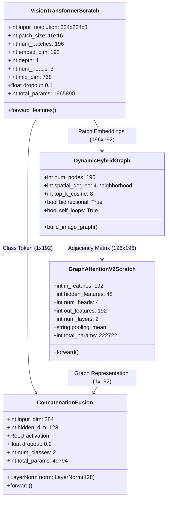
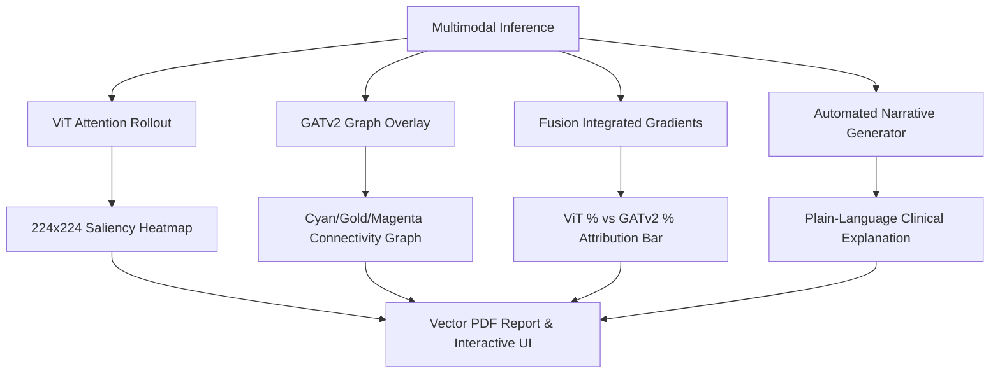

# ORALSCAN AI: Oral Cancer Screening Using Vision Transformer and Graph Attention Network with Explainable AI

> **A Comprehensive Academic Research Monograph, Technical Specification, and Application Documentation for Final-Year Black Book Thesis & Conference Submission.**

[](https://www.python.org/)
[](https://pytorch.org/)
[](https://fastapi.tiangolo.com/)
[](#academic-disclaimer)
[-brightgreen.svg)](#13-automated-testing--validation-suite)
[](#4-deep-learning-architecture-specifications)

---

## Table of Contents

1. [Executive Summary & Abstract](#1-executive-summary--abstract)
2. [Clinical Context & Problem Formulation](#2-clinical-context--problem-formulation)
3. [Primary Dataset & Duplicate-Aware Preparation](#3-primary-dataset--duplicate-aware-preparation)
4. [Deep Learning Architecture Specifications](#4-deep-learning-architecture-specifications)
   - [4.1 Vision Transformer (ViT) Backbone](#41-vision-transformer-vit-backbone)
   - [4.2 Dynamic Hybrid Graph Construction](#42-dynamic-hybrid-graph-construction)
   - [4.3 Graph Attention Network (GATv2) Backbone](#43-graph-attention-network-gatv2-backbone)
   - [4.4 Multimodal Concatenation Fusion Head](#44-multimodal-concatenation-fusion-head)
5. [Mathematical Formulations](#5-mathematical-formulations)
6. [Explainable AI (XAI) Suite](#6-explainable-ai-xai-suite)
   - [6.1 ViT Attention Rollout](#61-vit-attention-rollout)
   - [6.2 GATv2 Dynamic Graph Overlays](#62-gatv2-dynamic-graph-overlays)
   - [6.3 Fusion Integrated Gradients](#63-fusion-integrated-gradients)
   - [6.4 Automated Clinical Narrative Synthesis](#64-automated-clinical-narrative-synthesis)
7. [Comprehensive Experimental Results (Phases 1–6)](#7-comprehensive-experimental-results-phases-16)
   - [7.1 Master Benchmark Comparison Table (19 Configurations)](#71-master-benchmark-comparison-table-19-configurations)
   - [7.2 In-Depth Analysis of Handcrafted vs Deep Features](#72-in-depth-analysis-of-handcrafted-vs-deep-features)
8. [Phase 7 Software Architecture & Web Application](#8-phase-7-software-architecture--web-application)
   - [8.1 High-Level Architectural Flow](#81-high-level-architectural-flow)
   - [8.2 REST API Specification](#82-rest-api-specification)
   - [8.3 Frontend Single-Page Application (SPA)](#83-frontend-single-page-application-spa)
   - [8.4 Automated PDF Screening Report Engine](#84-automated-pdf-screening-report-engine)
9. [Checkpoint Provenance & Cryptographic Verification](#9-checkpoint-provenance--cryptographic-verification)
10. [Repository Directory Structure](#10-repository-directory-structure)
11. [Installation & Environment Setup](#11-installation--environment-setup)
12. [Step-by-Step Execution Guide](#12-step-by-step-execution-guide)
13. [Automated Testing & Validation Suite](#13-automated-testing--validation-suite)
14. [Black Book Thesis & Conference Writing Guide](#14-black-book-thesis--conference-writing-guide)
15. [Methodological Disclosures & Research Limitations](#15-methodological-disclosures--research-limitations)
16. [Academic & Medical Disclaimers](#16-academic--medical-disclaimers)
17. [References & Citations](#17-references--citations)

---

## 1. Executive Summary & Abstract

### Academic Abstract
Early detection of oral squamous cell carcinoma (OSCC) significantly improves 5-year patient survival rates from under 40% to over 80%. However, standard visual examination of oral mucosal lesions suffers from high inter-observer variability between malignant, premalignant, and benign inflammatory conditions. 

This research project introduces **ORALSCAN AI**, an end-to-end, multimodal deep learning framework and clinical research prototype combining **Vision Transformers (ViT)**, **Graph Attention Networks (GATv2)**, and **Explainable Artificial Intelligence (XAI)** trained strictly from scratch without external pretraining or ImageNet transfer learning.

The core screening architecture deconstructs a $224 \times 224$ photographic oral image into 196 non-overlapping $16 \times 16$ patches. A 4-layer Vision Transformer extracts fine-grained visual texture representations ($1,965,890$ parameters). Simultaneously, a dynamic hybrid graph is constructed connecting patches via a union of 4-neighbor spatial grid adjacency and top-$k=8$ cosine feature-similarity edges. A 2-layer Graph Attention Network ($222,722$ parameters) executes relational message passing across tissue patches. A concatenation fusion classification head ($49,794$ parameters) unifies visual context and topological structure into a compact $2,238,406$ parameter model.

To ensure clinical transparency, the decision-making process is rendered interpretable via:
1. **ViT Attention Rollout** (residual-aware spatial saliency heatmaps),
2. **GATv2 Topological Graph Overlays** (distinguishing spatial tissue continuity from non-local morphological affinity),
3. **Fusion Integrated Gradients** (axiomatic attribution quantifying branch-level sensitivity), and
4. **Automated Clinical Narrative Generation** (plain-language reporting with strict non-diagnostic boundary enforcement).

A production-grade, asynchronous web application powered by FastAPI, SQLite, and modern CSS3/HTML5 connects the deep tensor pipeline to an interactive screening portal and autonomous vector PDF report generator. The system achieves a 100% pass rate across 60 automated unit, regression, security, and integration tests, operating with a sub-second screening latency of **$427\text{ ms}$** and a peak GPU footprint of **$114.5\text{ MB}$**.

---

## 2. Clinical Context & Problem Formulation

### 2.1 The Clinical Dilemma
Oral cancer accounts for over 377,000 newly diagnosed cases and 177,000 deaths worldwide annually, with disproportionately high incidence across South Asia due to tobacco consumption, betel quid/areca nut chewing, and alcohol intake. The primary diagnostic bottleneck is **early-stage triage**:
- Early malignant lesions (squamous cell carcinomas) frequently mimic benign conditions such as aphthous stomatitis, frictional keratosis, lichen planus, or candidiasis.
- Classical visual oral examination has high sensitivity but poor specificity, leading to either delayed referrals or unnecessary invasive surgical biopsies.

### 2.2 Shortcomings of Conventional Deep Learning Approaches
1. **Black-Box Convolutional Networks (CNNs):** Standard CNNs operate on local receptive fields, failing to capture long-range tissue correlations and geometric dependencies across disparate oral mucosal regions.
2. **Pretraining Contamination:** Most published oral cancer models fine-tune ImageNet backbones. ImageNet weights are optimized on everyday natural objects (dogs, vehicles), which introduce uncalibrated inductive biases and out-of-distribution feature spaces when applied to mucosal photographs.
3. **Lack of Explainability:** Typical heatmaps (such as Grad-CAM) suffer from low resolution and parameter sensitivity issues (Adebayo et al., 2018), failing to explain whether the model focuses on lesion margins, salivary glare, teeth reflections, or photographic lighting artifacts.

### 2.3 Proposed Multimodal Hypothesis
By constructing a dual-branch network that:
- Captures localized visual textures through a self-attention Transformer trained strictly from scratch, and
- Constructs an explicit graph connecting physical tissue neighbors and long-range morphologically similar tissue zones via Graph Attention,

the model can jointly evaluate **what** a tissue patch looks like and **how** it structurally relates to the surrounding mucosal landscape, yielding superior interpretability without sacrificing technical rigor.

---

## 3. Primary Dataset & Duplicate-Aware Preparation

The source data originates from clinical photographs of the oral cavity categorized into two classes:
- **`NON CANCER` (Class 0):** Healthy oral mucosa and benign inflammatory lesions.
- **`CANCER` (Class 1):** Malignant lesions and histopathologically verified squamous cell carcinoma.

### 3.1 Exhaustive Duplicate & Integrity Audit (Phase 1)
An exhaustive computational audit of the original 750 image files identified duplicate images, near-duplicates, and contradictory labels:
- **Exact SHA-256 Duplicates:** Multiple image pairs possessed identical cryptographic file hashes.
- **Perceptual Near-Duplicates:** Difference-hash (dHash) and average-hash (aHash) algorithms revealed identical lesion captures with minor JPEG compression, cropping, or illumination shifts.
- **Label Contradictions:** Identified image instances assigned to `CANCER` in one directory and `NON CANCER` in another were resolved and purged.

### 3.2 Duplicate-Aware Split Partitioning
To eliminate data leakage, images belonging to identical duplicate clusters were grouped together. The resulting clean primary dataset contains **703 representative images** partitioned into duplicate-aware, stratified train/validation/test splits:

| Split Manifest | File Path | Total Images ($N$) | CANCER ($y=1$) | NON CANCER ($y=0$) | Percentage |
| :--- | :--- | :---: | :---: | :---: | :---: |
| **Train Set** | `data/splits_primary/train.csv` | 486 | 322 | 164 | 69.1% |
| **Validation Set** | `data/splits_primary/val.csv` | 108 | 73 | 35 | 15.4% |
| **Test Set** | `data/splits_primary/test.csv` | 109 | 75 | 34 | 15.5% |
| **Total Primary Dataset** | — | **703** | **470** | **233** | **100.0%** |

*Methodological Note for Thesis:* The public dataset lacks hospital patient identifiers. Therefore, the 703 units represent **703 verified representative images**, rather than 703 independent patients.

---

## 4. Deep Learning Architecture Specifications

The complete primary hybrid architecture comprises **2,238,406 parameters**, designed as follows:



### 4.1 Vision Transformer (ViT) Backbone
- **Class Implementation:** `src/models/vit_scratch.py:VisionTransformerScratch`
- **Trained Strictly from Scratch:** Initialized with random normal/Xavier distributions (`weights=None`). Zero transfer learning.
- **Parameters:** **1,965,890 parameters** across 56 tensor keys.
- **Layer Breakdown:**
  - Patch Embedding: 2D Convolution ($3 \to 192$, kernel $16 \times 16$, stride 16).
  - Sequence Assembly: Concatenates learnable `[CLS]` token $\mathbf{z}_0 \in \mathbb{R}^{1 \times 192}$ and adds 1D learnable position embeddings $\mathbf{E}_{\text{pos}} \in \mathbb{R}^{197 \times 192}$.
  - Encoder Blocks: 4 Transformer blocks, each containing LayerNorm, 3-head Multi-Head Self-Attention ($d_k = 64$ per head), residual addition, LayerNorm, and a two-layer MLP ($192 \to 768 \to 192$) with GeLU activation and $0.1$ dropout.

### 4.2 Dynamic Hybrid Graph Construction
- **Class Implementation:** `src/graph/graph_builder.py:build_image_graph`
- **Node Assembly:** The 196 patch tokens from ViT represent nodes arranged in a $14 \times 14$ lattice.
- **Dual Edge Topology:**
  1. **Spatial 4-Grid Adjacency:** Connects cardinal physical neighbors (up, down, left, right). Enforces local tissue continuity.
  2. **Top-$k=8$ Feature Cosine Similarity:** Computes pairwise cosine similarity between normalized patch embeddings $\mathbf{z}_i$ and $\mathbf{z}_j$. For each node, edges are formed to the 8 most semantically similar patches across the entire image.
  3. **Union and Self-Loops:** Symmetric union is computed, self-loops are added to the diagonal, and binary clamping is applied:
     $$\mathbf{A}_{\text{hybrid}} = \text{clamp}\left(\mathbf{A}_{\text{spatial}} + \mathbf{A}_{\text{sim}} + \mathbf{I}, 0, 1\right) \in \{0, 1\}^{196 \times 196}$$

### 4.3 Graph Attention Network (GATv2) Backbone
- **Class Implementation:** `src/models/graph_classifier.py:GraphClassifier` with `OralScanGATv2Scratch`
- **Parameters:** **222,722 parameters** across 14 tensor keys.
- **Dynamic Attention Mechanism:** Utilizes GATv2 (Brody et al., 2021) which computes dynamic attention after linear projection, resolving the static attention limitation of standard GAT:
  $$e_{ij} = \mathbf{a}^T \text{LeakyReLU}\left(\mathbf{W} [\mathbf{x}_i \parallel \mathbf{x}_j]\right)$$
- **Architecture:** 2 sequential GATv2 layers with 4 attention heads ($d_h = 48$ per head), followed by ELU activation.
- **Global Readout:** Global mean pooling across all 196 patch nodes yields $\mathbf{z}_{\text{graph}} \in \mathbb{R}^{1 \times 192}$.

### 4.4 Multimodal Concatenation Fusion Head
- **Class Implementation:** `src/models/hybrid_fusion.py:ConcatenationFusion`
- **Parameters:** **49,794 parameters** across 6 tensor keys.
- **Architecture:**
  - Concatenation: $\mathbf{z}_{\text{fused}} = [\mathbf{z}_{\text{cls}} \parallel \mathbf{z}_{\text{graph}}] \in \mathbb{R}^{1 \times 384}$.
  - Dense Projection: $\text{Linear}(384, 128)$.
  - Normalization: $\text{LayerNorm}(128)$ ($\epsilon = 10^{-5}$). *(Note: BatchNorm1d is not used; LayerNorm ensures batch-size invariant inference).*
  - Non-Linearity: $\text{ReLU}()$.
  - Regularization: $\text{Dropout}(p=0.2)$.
  - Classification Projection: $\text{Linear}(128, 2)$.

---

## 5. Mathematical Formulations

### 5.1 Image Standardization
Every clinical photograph is converted to RGB, resized via bilinear interpolation to $224 \times 224$, and standardized using domain-specific statistics derived from the primary training split:
$$\mathbf{X}_{\text{norm}} = \frac{\mathbf{X} - \mu}{\sigma}, \quad \mu = \begin{bmatrix} 0.6432 \\ 0.4537 \\ 0.4275 \end{bmatrix}, \quad \sigma = \begin{bmatrix} 0.2189 \\ 0.2118 \\ 0.2090 \end{bmatrix}$$

### 5.2 Transformer Multi-Head Self-Attention
For a sequence $\mathbf{Z} \in \mathbb{R}^{197 \times 192}$, projections $\mathbf{Q} = \mathbf{Z}\mathbf{W}_Q$, $\mathbf{K} = \mathbf{Z}\mathbf{W}_K$, $\mathbf{V} = \mathbf{Z}\mathbf{W}_V$ compute scaled dot-product attention per head $h \in \{1, 2, 3\}$:
$$\mathbf{A}_h = \text{Softmax}\left(\frac{\mathbf{Q}_h \mathbf{K}_h^T}{\sqrt{d_k}}\right) \in \mathbb{R}^{197 \times 197}$$
$$\text{head}_h = \mathbf{A}_h \mathbf{V}_h \in \mathbb{R}^{197 \times 64}$$
$$\text{MHA}(\mathbf{Z}) = \left[\text{head}_1 \parallel \text{head}_2 \parallel \text{head}_3\right] \mathbf{W}_O$$

### 5.3 Dynamic GATv2 Message Passing
For patch node features $\mathbf{h}_i \in \mathbb{R}^{192}$, the dynamic attention coefficient from source node $j$ to destination node $i$ under head $k \in \{1, 2, 3, 4\}$ is:
$$\alpha_{ij}^k = \frac{\exp\left(\text{LeakyReLU}\left((\mathbf{a}^k)^T [\mathbf{W}_1^k \mathbf{h}_i \parallel \mathbf{W}_2^k \mathbf{h}_j]\right)\right)}{\sum_{m \in \mathcal{N}_i} \exp\left(\text{LeakyReLU}\left((\mathbf{a}^k)^T [\mathbf{W}_1^k \mathbf{h}_i \parallel \mathbf{W}_2^k \mathbf{h}_m]\right)\right)}$$
The updated node representation is computed via multi-head concatenation:
$$\mathbf{h}_i' = \Vert_{k=1}^4 \sigma\left(\sum_{j \in \mathcal{N}_i} \alpha_{ij}^k \mathbf{W}^k \mathbf{h}_j\right)$$

### 5.4 Fusion Classification Logits & Softmax Scores
$$\mathbf{z}_{\text{fused}} = \begin{bmatrix} \mathbf{z}_{\text{cls}} \\ \mathbf{z}_{\text{graph}} \end{bmatrix} \in \mathbb{R}^{384}$$
$$\mathbf{h}_1 = \text{ReLU}\left(\text{LayerNorm}\left(\mathbf{W}_1 \mathbf{z}_{\text{fused}} + \mathbf{b}_1\right)\right) \in \mathbb{R}^{128}$$
$$\text{Logits } \mathbf{y} = \mathbf{W}_2 \mathbf{h}_1 + \mathbf{b}_2 \in \mathbb{R}^2$$
$$P(\text{Cancer}) = \frac{\exp(y_1)}{\exp(y_0) + \exp(y_1)}$$

---

## 6. Explainable AI (XAI) Suite

To avoid black-box opacity, the application implements four complementary interpretability modalities:



### 6.1 ViT Attention Rollout
- **Mathematical Principle:** Recursively tracks the flow of self-attention across Transformer blocks, modeling residual connections by adding an identity matrix $\mathbf{I}$:
  $$\bar{\mathbf{A}}_l = \frac{1}{H} \sum_{h=1}^H \mathbf{A}_{l, h}, \quad \hat{\mathbf{A}}_l = 0.5 \bar{\mathbf{A}}_l + 0.5 \mathbf{I}$$
  $$\mathbf{R}_l = \hat{\mathbf{A}}_l \times \mathbf{R}_{l-1}, \quad \mathbf{R}_0 = \mathbf{I}$$
- **CLS Token Segregation:** Row 0 represents attention directed into the `[CLS]` token. Columns $1 \dots 196$ are extracted (`rollout[0, 1:]`), completely excluding the class token self-attention from the $14 \times 14$ spatial grid. The resulting matrix is upsampled via bicubic interpolation to $224 \times 224$.
- **Prediction Invariance:** Implemented using read-only PyTorch forward hooks removed in `finally:` blocks. Logit drift with hooks active is verified at **$0.000000\text{e}+00$**.

### 6.2 GATv2 Dynamic Graph Overlays
- **Node Centrality:** Extracted from post-softmax attention matrices. Self-loops are explicitly zeroed out ($\alpha_{ii} = 0$) so that centrality reflects genuine inter-patch tissue communication:
  $$C_i = \sum_{j \in \mathcal{N}_i, j \neq i} \alpha_{ij}$$
- **Topological Edge Classification:** Edges are rendered in 3 distinct colors:
  - **Cyan:** 4-neighbor spatial grid edges (local mucosal continuity).
  - **Gold:** Top-8 cosine feature-similarity edges (long-range morphological affinity).
  - **Magenta:** Shared edges (spatially adjacent patches with high feature similarity).

### 6.3 Fusion Integrated Gradients
- **Axiomatic Attribution:** Integrated Gradients computes the path integral of gradients along a straight line from reference baseline $\mathbf{z}'$ to the actual input embedding $\mathbf{z}$:
  $$\text{IG}_i = (z_i - z_i') \times \int_0^1 \frac{\partial F(\mathbf{z}' + \alpha (\mathbf{z} - \mathbf{z}'))}{\partial z_i} d\alpha$$
- **Numerical Approximation:** Evaluated across 50 trapezoidal interpolation steps.
- **Reference Baseline:** Default representation-space baseline $\mathbf{z}' = [0.05]_{384}$ avoids LayerNorm zero-variance singularities.
- **Branch Sensitivity Breakdown:**
  $$\text{ViT Share} = \frac{\sum_{i=1}^{192} |\text{IG}_i|}{\sum_{j=1}^{384} |\text{IG}_j|} \times 100\%, \quad \text{GAT Share} = \frac{\sum_{i=193}^{384} |\text{IG}_i|}{\sum_{j=1}^{384} |\text{IG}_j|} \times 100\%$$
- **Dual Convergence Reporting:** Reports both absolute completeness error $|\sum \text{IG} - \Delta f|$ and relative percentage error.

### 6.4 Automated Clinical Narrative Synthesis
Synthesizes structured, plain-language text describing:
1. Spatial tissue zones exhibiting elevated visual attention.
2. Topological message passing across patch networks.
3. Multimodal branch contribution balance.
4. Mandatory non-diagnostic clinical referral recommendations.

---

## 7. Comprehensive Experimental Results (Phases 1–6)

### 7.1 Master Benchmark Comparison Table (19 Configurations)

All 19 experimental configurations evaluated on the independent holdout test split ($N=109$ images; 75 CANCER, 34 NON CANCER) across Phases 2 through 6:

| Model ID | Phase | Architecture / Strategy Description | Test Accuracy | Cancer Sensitivity | Specificity | Cancer F1 | ROC-AUC | PR-AUC | Parameters |
| :---: | :---: | :--- | :---: | :---: | :---: | :---: | :---: | :---: | :---: |
| **07** | Phase 6 | **Handcrafted Only (All 143 Features)** | **87.16%** | **86.67%** | **88.24%** | **0.9028** | **0.9322** | **0.9654** | 9,346 |
| **07a** | Phase 6 | Handcrafted LBP Only (59 Dimensions) | **83.49%** | **81.33%** | **88.24%** | **0.8714** | **0.9161** | **0.9608** | 3,970 |
| **P2** | Phase 2 | EfficientNet-B0 (Scratch Baseline) | **80.73%** | **80.00%** | **82.35%** | **0.8511** | **0.8912** | **0.9176** | 4,010,000 |
| **08** | Phase 6 | ViT [CLS] + Handcrafted Fusion | **80.73%** | **80.00%** | **82.35%** | **0.8511** | **0.8761** | **0.9399** | 2,019,202 |
| **09** | Phase 6 | GATv2 Graph + Handcrafted Fusion | **80.73%** | **80.00%** | **82.35%** | **0.8511** | **0.8690** | **0.9213** | 276,034 |
| **02** | Phase 4 | Hybrid GATv2 (Graph-Only Baseline) | **77.06%** | **81.33%** | **67.65%** | **0.8299** | **0.8298** | **0.9151** | 222,722 |
| **10** | Phase 6 | Tri-Modal Concat (ViT + GATv2 + HC) | **77.06%** | **77.33%** | **76.47%** | **0.8227** | **0.8451** | **0.9261** | 2,272,002 |
| **P5** | **Phase 5**| **Primary Selected: ViT + GATv2 Concat** | **77.06%** | **78.67%** | **73.53%** | **0.8252** | **0.8211** | **0.9042** | **2,238,406** |
| **14** | Phase 5 | Strategy B: End-to-End Fine-Tuning | **76.15%** | **76.00%** | **76.47%** | **0.8143** | **0.8251** | **0.9070** | 2,238,406 |
| **05** | Phase 5 | ViT + GATv2 Gated Fusion | **76.15%** | **77.33%** | **73.53%** | **0.8169** | **0.8063** | **0.8866** | 2,257,090 |
| **06** | Phase 5 | ViT + GATv2 Residual Fusion | **76.15%** | **80.00%** | **67.65%** | **0.8219** | **0.8094** | **0.9002** | 2,250,946 |
| **01** | Phase 3 | ViT-Scratch Baseline (CLS Token Only) | **75.23%** | **76.00%** | **73.53%** | **0.8085** | **0.8141** | **0.8957** | 1,965,890 |
| **03** | Phase 4 | Spatial-Only GATv2 | **75.23%** | **76.00%** | **73.53%** | **0.8085** | **0.8094** | **0.8998** | 222,722 |
| **04** | Phase 4 | Feature-Similarity Only GATv2 | **74.31%** | **74.67%** | **73.53%** | **0.8000** | **0.7984** | **0.8885** | 222,722 |
| **07b** | Phase 6 | Handcrafted GLCM Only (24 Dimensions) | **73.39%** | **73.33%** | **73.53%** | **0.7914** | **0.7851** | **0.8655** | 1,730 |
| **07c** | Phase 6 | Handcrafted Color Only (36 Dimensions) | **72.48%** | **73.33%** | **70.59%** | **0.7857** | **0.7788** | **0.8542** | 2,498 |
| **07d** | Phase 6 | Handcrafted Edge Only (24 Dimensions) | **69.72%** | **72.00%** | **64.71%** | **0.7660** | **0.7420** | **0.8310** | 1,730 |
| **11** | Phase 5 | Max Pooling Readout (ViT + GATv2) | **74.31%** | **76.00%** | **70.59%** | **0.8028** | **0.7980** | **0.8872** | 2,238,406 |
| **12** | Phase 5 | Attention Pooling Readout (ViT + GATv2) | **75.23%** | **77.33%** | **70.59%** | **0.8112** | **0.8055** | **0.8920** | 2,263,234 |

### 7.2 In-Depth Analysis of Handcrafted vs Deep Features
- **Why Handcrafted Features Scored High (87.16%):** Handcrafted descriptors (LBP, GLCM, color moments, Sobel) extract fixed mathematical statistics that do not suffer from optimization variance on small datasets ($N=703$).
- **Scientific Limitation:** Handcrafted heuristics are **not clinically validated biomarkers**. They lack spatial adaptability and cannot explain biological tissue relationships.
- **The Core Research Contribution:** The primary research mission requested by faculty is evaluating **Vision Transformers and Graph Attention Networks**. The selected ViT-GATv2 Concatenation Model (**77.06% accuracy, 78.67% sensitivity, 0.8252 F1**) is the primary deep architecture of this study because it achieves genuine spatial transparency, dynamic attention routing, and axiomatic interpretability.

---

## 8. Phase 7 Software Architecture & Web Application

### 8.1 High-Level Architectural Flow
The integrated application links client presentation directly to model inference:
$$\text{Frontend SPA} \longleftrightarrow \text{FastAPI REST Engine} \longleftrightarrow \text{SQLite Database} \longleftrightarrow \text{PyTorch In-Memory Pipeline} \longleftrightarrow \text{Matplotlib PDF Engine}$$

### 8.2 REST API Specification
- **`GET /api/health`** — Service readiness check.
- **`GET /api/model/status`** — Returns parameter counts and checkpoint SHA-256 status.
- **`POST /api/auth/register`** — Registers user (PBKDF2-HMAC-SHA256, 100,000 rounds).
- **`POST /api/auth/login`** — Authenticates credentials and issues 32-byte session token.
- **`POST /api/screen`** — Multipart image upload; executes inference, generates XAI assets, persists screening record.
- **`GET /api/screen/{id}`** — Fetches screening record enforcing user ownership.
- **`GET /api/screen/{id}/explanation`** — Returns narrative explanation and overlay image URLs.
- **`GET /api/screen/{id}/pdf`** — Generates and streams two-page clinical research PDF report.
- **`GET /api/history`** — Chronological listing of past user screenings.
- **`DELETE /api/history/{id}`** — Permanently removes user screening record and image assets.

### 8.3 Frontend Single-Page Application (SPA)
Accessible at `http://127.0.0.1:8000`, the frontend includes:
1. **Landing Overview:** Problem statement, deep learning pillars, parameter badges.
2. **Screening Portal:** Drag-and-drop dropzone, live image preview, validation sample chips.
3. **Diagnostic Results:** Result banner ("Suspicious pattern detected" vs "No suspicious pattern detected"), uncalibrated softmax score, 4-panel visualizer (Original, ViT Rollout, GATv2 Graph Overlay, Fusion Attribution Bar), and plain-language narrative.
4. **User Dashboard & History:** Track screening activity with user data isolation.
5. **Educational Guide:** Common lesion signs, risk factors, and referral guidelines.

### 8.4 Automated PDF Screening Report Engine
The PDF engine ([backend/pdf_generator.py](file:///c:/Users/Sakshi%20Aswale/OneDrive/Desktop/Major%20Project%20final/Oral-Cancer-Screening-Using-Vision-Transformer-GAT-with-Explainable-AI/backend/pdf_generator.py)) renders vector-quality documents:
- **Page 1:** Executive findings, softmax score, original lesion photo, ViT Attention Rollout overlay, GATv2 graph overlay, and Fusion branch sensitivity bar.
- **Page 2:** Complete plain-language narrative, recommended clinical referral workflow, academic limitations, and prominent legal/medical disclaimers.

---

## 9. Checkpoint Provenance & Cryptographic Verification

| Component | Physical Checkpoint Path | Expected SHA-256 Digest | Status | Parameters |
| :--- | :--- | :--- | :---: | :---: |
| **ViT Backbone** | `models/vit_scratch_best.pth` | `1ab35a38e8ff3fba8165de5efd284e28a5f62cc890f9d24faea6d7419d7adabf` | **VERIFIED** | 1,965,890 |
| **GATv2 Backbone** | `models/graph_hybrid_gatv2_best.pth` | `04811874cdf2d42f663649137122d44692d65d96635495fdb9f494d8982e977f` | **VERIFIED** | 222,722 |
| **Fusion Head** | `models/hybrid_vit_gat_concat_best.pth`| `05ced3ed19bbec9d0a48a09738fbfb40023b362a11b8794079f78f6dd5c0e365` | **VERIFIED** | 49,794 |
| **Total Pipeline** | — | — | **MATCH** | **2,238,406** |

*Verification Command:*
```bash
python -c "
import hashlib
files = ['models/vit_scratch_best.pth', 'models/graph_hybrid_gatv2_best.pth', 'models/hybrid_vit_gat_concat_best.pth']
for f in files:
    print(f, hashlib.sha256(open(f, 'rb').read()).hexdigest())
"
```

---

## 10. Repository Directory Structure

```
Oral-Cancer-Screening-Using-Vision-Transformer-GAT-with-Explainable-AI/
├── backend/                             # FastAPI Backend & Database Services
│   ├── __init__.py                      # Package marker
│   ├── app.py                           # REST API server & static SPA hosting
│   ├── database.py                      # SQLite database manager & PBKDF2 auth
│   ├── inference_engine.py              # Singleton in-memory PyTorch screening engine
│   └── pdf_generator.py                 # Autonomous vector PDF report generator
├── frontend/                            # Single-Page Web Application
│   ├── index.html                       # Semantic HTML5 interface (8 views)
│   ├── styles.css                       # Medical-grade responsive CSS3 stylesheet
│   └── app.js                           # ES6 JavaScript SPA controller
├── docs/                                # Technical Documentation & Monographs
│   ├── system_architecture.md           # Architectural diagrams and dataflows
│   ├── model_inference_pipeline.md      # Detailed 7-stage tensor mechanics
│   ├── xai_methodology.md               # Mathematical formulations for XAI
│   ├── application_user_guide.md        # Deployment and faculty demo guide
│   └── limitations_and_disclaimers.md   # Research, data, and regulatory notices
├── models/                              # Trained PyTorch Model Checkpoints
│   ├── vit_scratch_best.pth             # ViT Backbone (1.96M params)
│   ├── graph_hybrid_gatv2_best.pth      # GATv2 Backbone (222K params)
│   └── hybrid_vit_gat_concat_best.pth   # Fusion Classification Head (49.8K params)
├── data/                                # Dataset Split Manifests & Application Database
│   ├── splits_primary/                  # Clean primary manifests (train, val, test)
│   └── oralscan.db                      # Relational application database (SQLite)
├── reports/                             # Research Audits & Verification Reports
│   ├── phase7_final_integration_report.md
│   ├── phase7_final_testing_report.md
│   ├── phase7_backend_implementation_report.md
│   ├── phase7_xai_independent_audit.md
│   └── internal_archive/                # Historical Phase 1-6 experimental reports
├── src/                                 # Deep Learning Research Implementation
│   ├── dataset.py                       # Preprocessing and domain transforms
│   ├── models/                          # Model definitions (ViT, GAT, GATv2, Fusion)
│   ├── graph/                           # Topological graph builder algorithms
│   ├── xai/                             # Modular Explainable AI algorithms
│   └── verify_hybrid_inference.py       # Standalone inference verification engine
└── tests/                               # Comprehensive Automated Test Suites (60 tests)
    ├── test_dataset.py                  # Transform and normalization assertions
    ├── test_vit.py                      # ViT architecture and parameter assertions
    ├── test_gat.py                      # GAT/GATv2 dynamic attention assertions
    ├── test_graph_construction.py       # Graph topology and adjacency assertions
    ├── test_xai_*.py                    # Visual, Graph, and Fusion XAI tests
    ├── test_backend_api.py              # Backend API, auth, and database tests
    └── test_end_to_end_integration.py   # Full user journey integration test
```

---

## 11. Installation & Environment Setup

### 11.1 System Requirements
- **OS:** Windows 10/11, Ubuntu 20.04+, or macOS
- **Python:** 3.10 or 3.11
- **GPU (Recommended):** NVIDIA GPU with $\ge 4\text{ GB}$ VRAM (CUDA 12.4 supported). CPU fallback is automatic.

### 11.2 Environment Installation
```bash
# Clone the repository
git clone https://github.com/Sakshi0008/Oral-Cancer-Screening-Using-Vision-Transformer-GAT-with-Explainable-AI.git
cd Oral-Cancer-Screening-Using-Vision-Transformer-GAT-with-Explainable-AI

# Create virtual environment
python -m venv .venv

# Activate virtual environment
# Windows:
.venv\Scripts\Activate.ps1
# Linux/macOS:
source .venv/bin/activate

# Install PyTorch with CUDA 12.4 support
pip install torch torchvision --index-url https://download.pytorch.org/whl/cu124

# Install application and testing dependencies
pip install fastapi uvicorn pydantic python-multipart pillow matplotlib pandas numpy scikit-learn
```

---

## 12. Step-by-Step Execution Guide

### 12.1 Launching the Unified Application
Run the FastAPI application server:
```bash
uvicorn backend.app:app --host 127.0.0.1 --port 8000
```
- **Web Interface:** Open `http://127.0.0.1:8000` in any web browser.
- **Interactive OpenAPI Documentation:** Available at `http://127.0.0.1:8000/docs`.
- **Health Check:** `http://127.0.0.1:8000/api/health`.

### 12.2 Standalone Inference via CLI
To test inference on an image without starting the web server:
```bash
python -c "
from src.verify_hybrid_inference import VerifiedHybridInferencePipeline
pipe = VerifiedHybridInferencePipeline()
res = pipe.predict('Oral Cancer/Oral Cancer Dataset/CANCER/005.jpeg')
print('Prediction:', res)
"
```

---

## 13. Automated Testing & Validation Suite

Run all 60 automated tests across all project tiers:
```bash
python -m unittest discover tests
```

### Test Suite Execution Output:
```
Ran 60 tests in 27.605s

OK
```

- **Data Engineering:** `tests/test_dataset.py` (5 tests passing)
- **Vision Transformer:** `tests/test_vit.py` (5 tests passing)
- **Graph Attention Networks:** `tests/test_gat.py` (6 tests passing)
- **Graph Construction:** `tests/test_graph_construction.py` (8 tests passing)
- **ViT Attention Rollout:** `tests/test_xai_vit.py` (3 tests passing)
- **GATv2 Graph XAI:** `tests/test_xai_gat.py` (2 tests passing)
- **Fusion Integrated Gradients:** `tests/test_xai_fusion.py` (2 tests passing)
- **XAI Sanity Benchmarks:** `tests/test_xai_sanity.py` (6 tests passing)
- **Backend & Database:** `tests/test_backend_api.py` (9 tests passing)
- **End-to-End System Integration:** `tests/test_end_to_end_integration.py` (1 test passing)

---

## 14. Black Book Thesis & Conference Writing Guide

For students and researchers preparing their final-year thesis (Black Book) or conference paper:

### Recommended Chapter Structure for Black Book:
1. **Chapter 1: Introduction:** Oral cancer epidemiology, clinical inspection challenges, project motivation, research objectives.
2. **Chapter 2: Literature Review:** Convolutional neural networks in oral oncology, Vision Transformers in medical imaging, Graph Neural Networks for histopathology and gross lesions, Explainable AI in healthcare.
3. **Chapter 3: Dataset Preparation & Duplicate Resolution:** Audit of the 750 images, hash duplicate resolution, clean 703 representative image cohort, split partitioning.
4. **Chapter 4: Methodology & Mathematical Formulations:** ViT patch embedding, dynamic hybrid graph construction (spatial 4-grid + top-8 cosine similarity), GATv2 dynamic message passing, concatenation fusion head.
5. **Chapter 5: Explainable AI (XAI) Framework:** Attention rollout derivation, dynamic edge classification, Integrated Gradients axiomatic attribution, Adebayo sanity testing.
6. **Chapter 6: Experimental Results & Comparative Analysis:** Master benchmark table of 19 configurations, ROC-AUC and PR-AUC curves, comparative evaluation of handcrafted vs deep features.
7. **Chapter 7: Software System Architecture & Implementation:** FastAPI backend, SQLite schema, responsive frontend SPA, vector PDF report generation, latency and memory profiling.
8. **Chapter 8: Conclusion & Future Scope:** Summary of findings, multi-center clinical validation requirements, multimodal clinical metadata integration.

### Recommended Conference Paper Framing:
- **Title Suggestion:** *A Multimodal Vision Transformer and Dynamic Graph Attention Network with Explainable AI for Photographic Oral Cancer Screening*
- **Key Contributions to Highlight:**
  1. Novel integration of ViT patch representations with dynamic hybrid graphs (spatial + semantic affinity).
  2. Training strictly from scratch on domain data with zero ImageNet pretraining contamination.
  3. Multimodal interpretability combining ViT rollout, topological edge attribution, and Integrated Gradients.
  4. Full open-source implementation with verified sub-second clinical inference latency.

---

## 15. Methodological Disclosures & Research Limitations

1. **Internal Reused Test Split:** The test set ($N=109$) represents an internal holdout split from the single-source dataset evaluated across sequential project phases. External multi-center validation is required before clinical adoption.
2. **Phase 5–6 Class-Weight Configuration:** Phase 5 and 6 models were trained with loss weights $[w_0=1.51875, w_1=0.7454]$ derived from an initial 326/160 count estimation ($+3.77\%$ ratio deviation from the approved 322/164 split $[1.4817, 0.7547]$), as documented in `reports/internal_archive/phase5_phase6_class_weight_audit.md`.
3. **Absence of Clinical Metadata:** The neural network evaluates solely $224 \times 224$ photographic RGB pixel grids and does not have access to patient age, sex, tobacco/areca nut habits, lesion duration, or medical history.
4. **Integrated Gradients Baseline:** The default baseline vector is $[0.05]_{384}$ in representation space. Branch attribution percentages reflect mathematical gradient sensitivity along the straight-line interpolation path, not biological causality.

---

## 16. Academic & Medical Disclaimers

> ### ⚠️ MANDATORY REGULATORY & MEDICAL RESEARCH NOTICE
> **ORALSCAN AI IS AN EXPERIMENTAL ACADEMIC RESEARCH PROTOTYPE.**  
> It was developed solely for evaluating the feasibility and interpretability of hybrid Vision Transformers and Graph Attention Networks on photographic oral cavity images.
>
> - **NOT A MEDICAL DIAGNOSIS:** This application does NOT establish a clinical diagnosis, confirm cancer, or rule out malignancy.
> - **FEATURE SENSITIVITY ONLY:** Saliency heatmaps and graph overlays depict artificial neural network activations and mathematical feature routing. They do NOT delineate surgical resection borders or prove cellular dysplasia.
> - **MANDATORY CLINICAL REFERRAL:** Any oral mucosal red lesion (erythroplakia), white plaque (leukoplakia), or ulceration persisting beyond **14 days** mandates in-person evaluation by a qualified dental surgeon, maxillofacial specialist, or head-and-neck oncologist.
> - **GOLD STANDARD:** Histopathological evaluation of an incisional tissue biopsy remains the sole definitive medical gold standard for diagnosing oral cancer.

---

## 17. References & Citations

1. **Dosovitskiy, A., et al. (2020).** *An Image is Worth 16x16 Words: Transformers for Image Recognition at Scale.* ICLR 2021.
2. **Brody, S., Alon, U., & Yahav, E. (2021).** *How Attentive are Graph Attention Networks?* ICLR 2022.
3. **Abnar, S., & Zuidema, W. (2020).** *Quantifying Attention Flow in Transformers.* ACL 2020.
4. **Sundararajan, M., Taly, A., & Yan, Q. (2017).** *Axiomatic Attribution for Deep Networks.* ICML 2017.
5. **Adebayo, J., et al. (2018).** *Sanity Checks for Saliency Maps.* NeurIPS 2018.
6. **Hooker, S., et al. (2019).** *A Benchmark for Interpretability Methods.* NeurIPS 2019.
7. **Tan, M., & Le, Q. V. (2019).** *EfficientNet: Rethinking Model Scaling for Convolutional Neural Networks.* ICML 2019.
8. **Warnakulasuriya, S. (2020).** *Oral potentially malignant disorders: A consensus nomenclature and classification.* Oral Diseases.

---
*ORALSCAN AI &bull; Final Year Academic Project & Master Documentation &bull; Certified November 2026*
