# ORALSCAN AI: Model Inference Pipeline Documentation

**Project:** Oral Cancer Screening Using Vision Transformer and Graph Attention Network with Explainable AI  
**Subject:** Deterministic Preprocessing, Multimodal Feature Extraction, Graph Construction, and Prediction Mechanics  
**Date:** November 2026  

---

## 1. End-to-End Inference Workflow

Every oral cavity photograph submitted through the screening engine undergoes an unvarying, deterministic 7-stage evaluation pipeline:

```mermaid
flowchart LR
    A["Raw Clinical Photo (JPEG/PNG)"] --> B["Stage 1: Validation & Normalization"]
    B --> C["Stage 2: ViT Patch Extraction (196 x 192)"]
    C --> D["Stage 3: Hybrid Graph Generation"]
    D --> E["Stage 4: GATv2 Message Passing"]
    E --> F["Stage 5: Concatenation Fusion Head"]
    F --> G["Stage 6: Logits & Softmax Scores"]
    G --> H["Stage 7: Cautious Clinical Classification"]
```

---

## 2. Granular Stage Specifications

### Stage 1: Image Validation and Domain Preprocessing
- **Validation:** Input files are validated via PIL `Image.open().verify()` to detect corruption, truncated streams, or malicious payloads.
- **Color Conversion:** Converted deterministically to 3-channel RGB.
- **Resolution Resizing:** Scaled to $224 \times 224$ pixels using standard bilinear interpolation (`transforms.Resize((224, 224))`).
- **Primary Domain Normalization:** Standardized using the approved primary dataset mean and standard deviation:
  $$\mu = [0.6432, 0.4537, 0.4275], \quad \sigma = [0.2189, 0.2118, 0.2090]$$
  *(Note: Standard ImageNet statistics [0.485, 0.456, 0.406] are strictly prohibited to prevent distribution shifts).*

### Stage 2: Vision Transformer Patch & Class Token Extraction
- **Input:** Normalized tensor $\mathbf{X} \in \mathbb{R}^{1 \times 3 \times 224 \times 224}$.
- **Patch Projection:** Conv2d with kernel size $16 \times 16$, stride 16, projecting into $d=192$ dimensions.
- **Sequence Assembly:** Prepends learnable class token $\mathbf{z}_0 = [\text{CLS}]$ and adds fixed 1D learnable position embeddings to the sequence of length 197.
- **Transformer Forward Pass:** Passes through 4 Transformer encoder layers (LayerNorm, Multi-Head Self-Attention with 3 heads, MLP with hidden dim 768).
- **Extracted Representations:**
  - Class token $\mathbf{z}_{\text{cls}} \in \mathbb{R}^{1 \times 192}$ (row 0).
  - Spatial patch tokens $\mathbf{Z}_{\text{patch}} \in \mathbb{R}^{1 \times 196 \times 192}$ (rows 1 through 196).

### Stage 3: Dynamic Hybrid Graph Construction
- **Nodes:** The 196 spatial patch tokens serve as graph nodes $V = \{v_1, \dots, v_{196}\}$ arranged in a $14 \times 14$ lattice.
- **Spatial Grid Topology:** Connects every node to its 4 cardinal spatial neighbors (up, down, left, right) on the $14 \times 14$ grid:
  $$\mathbf{A}_{\text{spatial}}[i, j] = 1 \iff \text{dist}_{\text{grid}}(v_i, v_j) = 1$$
- **Feature-Similarity Topology:** Computes pairwise cosine similarity between all 196 patch embeddings:
  $$S_{ij} = \frac{\mathbf{z}_i \cdot \mathbf{z}_j}{\|\mathbf{z}_i\|_2 \|\mathbf{z}_j\|_2}$$
  For each node $i$, selects the top $k = 8$ highest similarity nodes and adds bidirectional edges.
- **Union and Self-Loops:** Combines spatial and similarity edges into an undirected binary adjacency matrix $\mathbf{A} \in \{0, 1\}^{196 \times 196}$, with diagonal self-loops added:
  $$\mathbf{A}_{\text{hybrid}} = \text{clamp}\left(\mathbf{A}_{\text{spatial}} + \mathbf{A}_{\text{sim}} + \mathbf{I}, 0, 1\right)$$

### Stage 4: GATv2 Relational Message Passing
- **Input:** Node feature matrix $\mathbf{Z}_{\text{patch}} \in \mathbb{R}^{1 \times 196 \times 192}$ and adjacency $\mathbf{A}_{\text{hybrid}}$.
- **Layer 1:** 4 attention heads ($48$ dims each), projecting to 192 dimensions with dynamic attention coefficients $\alpha_{ij}^{(1)}$ and ELU non-linearity.
- **Layer 2:** 4 attention heads ($48$ dims each), computing refined patch relational features $\mathbf{H}^{(2)} \in \mathbb{R}^{1 \times 196 \times 192}$.
- **Graph Pooling:** Mean pooling across all 196 nodes produces a single global graph representation:
  $$\mathbf{z}_{\text{graph}} = \frac{1}{196} \sum_{i=1}^{196} \mathbf{h}_i^{(2)} \in \mathbb{R}^{1 \times 192}$$

### Stage 5: Multimodal Concatenation Fusion
- Concatenates the ViT visual class token and the GATv2 pooled graph embedding:
  $$\mathbf{z}_{\text{fused}} = [\mathbf{z}_{\text{cls}} \parallel \mathbf{z}_{\text{graph}}] \in \mathbb{R}^{1 \times 384}$$
- Passes through the trained fusion classification head:
  $$\mathbf{h}_1 = \text{ReLU}\left(\text{LayerNorm}\left(\mathbf{W}_1 \mathbf{z}_{\text{fused}} + \mathbf{b}_1\right)\right)$$
  $$\text{Logits } \mathbf{y} = \mathbf{W}_2 \mathbf{h}_1 + \mathbf{b}_2 \in \mathbb{R}^{1 \times 2}$$

### Stage 6 & 7: Probability Calculation and Cautious Phrasing
- Softmax scores:
  $$P(\text{Class } c) = \frac{\exp(y_c)}{\sum_{k=0}^1 \exp(y_k)}$$
- Output Mapping:
  - Class 0 ($P(\text{Cancer}) < 0.50$): **"No suspicious pattern detected by the model."**
  - Class 1 ($P(\text{Cancer}) \ge 0.50$): **"Suspicious pattern detected by the model."**
- Softmax scores are explicitly presented as uncalibrated algorithmic confidence scores, never as clinical disease probabilities.
